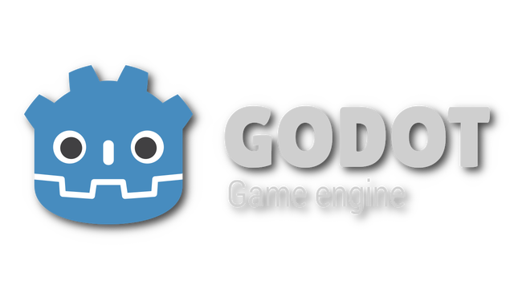
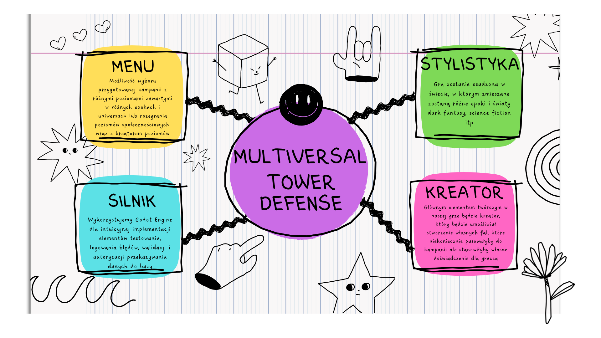
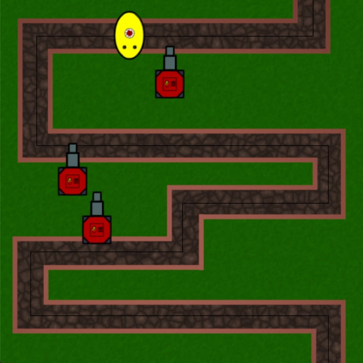

# Multiversal TD (placeholder)
### Gra tower defense łącząca wiele epok i światów z edytorem map i fal przeciwników
Tworzymy grę tower defense z podstawowymi poziomami jak i możliwością tworzenia własnych poziomów, które zostaną zapisane do bazy danych umożliwiając innym graczom zagranie map społecznościowych.
### Technologie
Gra powstaje na silniku Godot Engine, który dostarcza możliwości testowania aplikacji, logowania błędów itp. Tworzenie map zostanie połączone z internetową bazą danych, do której gracze będą mogli dodawać własnoręcznie tworzone poziomy z walidacją poprzez API. 

### Plan działania

### Prototyp

